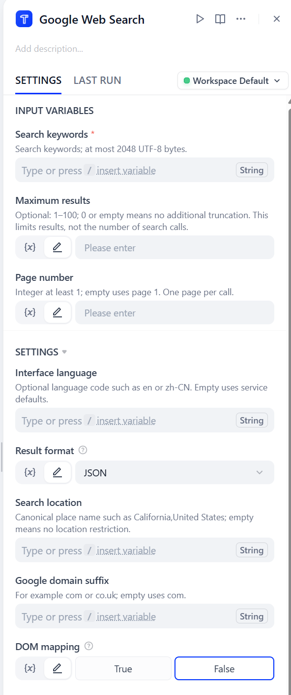
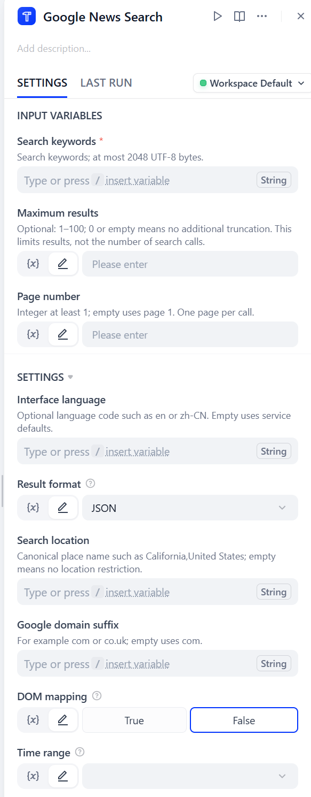
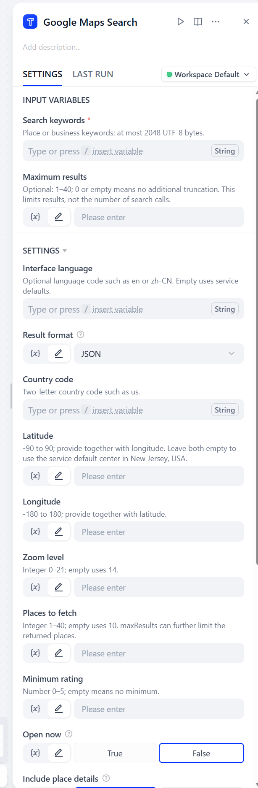

# glorycloud SERP API

Search Google web pages, images, shopping listings, news and maps from your Dify workflows. Use the results for web research, content summaries, product comparisons and business discovery.

Author: glorycloud

Source repository: [GoProxyTeam/Dify-glorycloud-serp-api](https://github.com/GoProxyTeam/Dify-glorycloud-serp-api)

## Google Web Search

Search Google for structured web results with GloryCloud. Gather information for online research and content summaries. New users receive $1 in signup credit, redeemable for 1,000 free queries.

### Overview

Google Web Search by GloryCloud retrieves structured Google web search results within Dify workflows. Search by keyword and adjust the language, location, Google domain, result limit, and page to suit your query.

Use the results for online research and content organization, or pass them to an LLM node for summarization or a code node for further processing. Searches use your GloryCloud API Key and account quota.

[API Documentation](https://docs.glorycloud.com/api-reference/SERP-API/Use?link=1142bb) · Pricing

### Getting Started

#### 1. Get Your API Key

Sign in to your GloryCloud account and obtain your API Key from your [account settings](https://www.glorycloud.com/dashboard/settings/?link=1142bb). Make sure your account has available quota.

#### 2. Install and Authorize

1. Click Install on this page to add the plugin to your Dify workspace.

2. Open the plugin’s authorization settings and create a credential.

3. Enter your GloryCloud API Key, choose who can use the credential, and save it.

Notice: Not available for use in mainland China.

#### 3. Use the Tool in Your Workflow

1. Add the plugin’s tool to your Dify workflow.

2. Choose your saved credential.

3. Enter a search query or connect a string variable from an upstream node.

4. Configure the tool’s parameters. For details, see the GloryCloud API documentation.

5. Run the node and review the JSON output. Then pass the results to an output node, or use an LLM or code node for further processing.

### Example

Search for information about GloryCloud using these settings:

- Search keywords: GloryCloud

- Interface language: en

- Maximum results: 5

- Search location: California,United States

- Google domain suffix: com

- Page number: 1

- Result format: JSON

Run the node to view the search results and request ID. The actual number of results may be lower than the maximum requested.



### Troubleshooting

#### Why did my search fail after I saved my credential?

Check your API Key, account status, search type permissions, and available quota. Saving a credential does not perform a search or confirm that your account can use the selected tool.

#### What should I do if I receive a parameter error?

Check that the parameters are supported by the Web Search API and that their values are within the allowed range.

#### Why did my search return no results or fewer results than expected?

Try a different query or reduce the number of filters. A successful search can return no results, and the maximum results setting does not guarantee a specific number of results.

#### What should I do if I reach the rate limit?

Reduce concurrent requests and try again later.

#### What should I do if my search times out?

Check your usage before retrying, as the original search may still complete and incur a charge. The plugin does not retry automatically.

#### Why can’t a downstream node access the search results?

Make sure the downstream node is connected to the tool’s JSON output. Select the first item in the output array, then read data.result.

### Support

For help, contact support@glorycloud.com. To keep your account secure, please leave out your API Key when sharing messages or screenshots.

## Google Image Search

Search Google for images, thumbnails, and source information with GloryCloud. Find images and organize their sources. New users receive $1 in signup credit, redeemable for 1,000 free queries.

### Overview

Google Image Search by GloryCloud retrieves images, thumbnails, and source information from Google within Dify workflows. Search by keyword and customize the interface language, search location, Google domain, result limit, and page.

Pass the structured results to subsequent nodes to organize image and source information or process the data further. Searches use your GloryCloud API Key and account quota.

[API Documentation](https://docs.glorycloud.com/api-reference/SERP-API/Use?link=1142bb) · Pricing

### Getting Started

#### 1. Get Your API Key

Sign in to your GloryCloud account and obtain your API Key from your [account settings](https://www.glorycloud.com/dashboard/settings/?link=1142bb). Make sure your account has available quota.

#### 2. Install and Authorize

1. Click Install on this page to add the plugin to your Dify workspace.

2. Open the plugin’s authorization settings and create a credential.

3. Enter your GloryCloud API Key, choose who can use the credential, and save it.

Notice: Not available for use in mainland China.

#### 3. Use the Tool in Your Workflow

1. Add the plugin’s tool to your Dify workflow.

2. Choose your saved credential.

3. Enter a search query or connect a string variable from an upstream node.

4. Configure the tool’s parameters. For details, see the GloryCloud API documentation.

5. Run the node and review the JSON output. Then pass the results to an output node, or use an LLM or code node for further processing.

### Example

Search for mountain landscape images using these settings:

- Search keywords: mountain landscape

- Maximum results: 5

- Page number: 1

- Interface language: en

- Result format: JSON

- Search location: California,United States

- Google domain suffix: com

- DOM mapping: False

Run the node to view images, thumbnails, and source information in the JSON output. The actual number of results may be lower than the maximum requested.

### Troubleshooting

#### Why did my search fail after I saved my credential?

Check your API Key, account status, search type permissions, and available quota. Saving a credential does not perform a search or confirm that your account can use the selected tool.

#### What should I do if I receive a parameter error?

Check that the parameters are supported by the Image Search API and that their values are within the allowed range.

#### Why did my search return no results or fewer results than expected?

Try a different query or reduce the number of filters. A successful search can return no results, and the maximum results setting does not guarantee a specific number of results.

#### What should I do if I reach the rate limit?

Reduce concurrent requests and try again later.

#### What should I do if my search times out?

Check your usage before retrying, as the original search may still complete and incur a charge. The plugin does not retry automatically.

#### Why can’t a downstream node access the search results?

Make sure the downstream node is connected to the tool’s JSON output. Select the first item in the output array, then read data.result.

### Support

For help, contact support@glorycloud.com. To keep your account secure, please leave out your API Key when sharing messages or screenshots.

## Google Shopping Search

Search Google Shopping for product listings, prices, and merchant information with GloryCloud. Compare offers and organize product information. New users receive $1 in signup credit, redeemable for 1,000 free queries.

### Overview

Google Shopping Search by GloryCloud retrieves product listings, prices, and merchant information within Dify workflows. Search by product name or keyword, specify the search location and interface language, and choose the Google domain and results page.

Use the results to compare product offers and organize pricing and merchant information. Structured output can be passed to an LLM node for summarization or a code node for further processing. Searches use your GloryCloud API Key and account quota.

[API Documentation](https://docs.glorycloud.com/api-reference/SERP-API/Use?link=1142bb) · Pricing

### Getting Started

#### 1. Get Your API Key

Sign in to your GloryCloud account and obtain your API Key from your [account settings](https://www.glorycloud.com/dashboard/settings/?link=1142bb). Make sure your account has available quota.

#### 2. Install and Authorize

1. Click Install on this page to add the plugin to your Dify workspace.

2. Open the plugin’s authorization settings and create a credential.

3. Enter your GloryCloud API Key, choose who can use the credential, and save it.

Notice: Not available for use in mainland China.

#### 3. Use the Tool in Your Workflow

1. Add the plugin’s tool to your Dify workflow.

2. Choose your saved credential.

3. Enter a search query or connect a string variable from an upstream node.

4. Configure the tool’s parameters. For details, see the GloryCloud API documentation.

5. Run the node and review the JSON output. Then pass the results to an output node, or use an LLM or code node for further processing.

### Example

Search for wireless headphones using these settings:

- Search keywords: wireless headphones

- Maximum results: 5

- Page number: 1

- Interface language: en

- Result format: JSON

- Search location: California,United States

- Google domain suffix: com

- DOM mapping: False

Run the node to view product listings, prices, and merchant information in the JSON output. The actual number of results may be lower than the maximum requested.

### Troubleshooting

#### Why did my search fail after I saved my credential?

Check your API Key, account status, search type permissions, and available quota. Saving a credential does not perform a search or confirm that your account can use the selected tool.

#### What should I do if I receive a parameter error?

Check that the parameters are supported by the Shopping Search API and that their values are within the allowed range.

#### Why did my search return no results or fewer results than expected?

Try a different query or reduce the number of filters. A successful search can return no results, and the maximum results setting does not guarantee a specific number of results.

#### What should I do if I reach the rate limit?

Reduce concurrent requests and try again later.

#### What should I do if my search times out?

Check your usage before retrying, as the original search may still complete and incur a charge. The plugin does not retry automatically.

#### Why can’t a downstream node access the search results?

Make sure the downstream node is connected to the tool’s JSON output. Select the first item in the output array, then read data.result.

### Support

For help, contact support@glorycloud.com. To keep your account secure, please leave out your API Key when sharing messages or screenshots.

## Google News Search

Search Google News by keyword and time range with GloryCloud. Find coverage for topic briefings and news summaries. New users receive $1 in signup credit, redeemable for 1,000 free queries.

### Overview

Google News Search by GloryCloud retrieves structured news search results within Dify workflows. Search by keyword and filter by time range to find coverage of a topic, company, or event.

Use the results to research news coverage and organize articles, or pass them to an LLM node for summarization or a code node for further processing. Searches use your GloryCloud API Key and account quota.

[API Documentation](https://docs.glorycloud.com/api-reference/SERP-API/Use?link=1142bb) · Pricing

### Getting Started

#### 1. Get Your API Key

Sign in to your GloryCloud account and obtain your API Key from your [account settings](https://www.glorycloud.com/dashboard/settings/?link=1142bb). Make sure your account has available quota.

#### 2. Install and Authorize

1. Click Install on this page to add the plugin to your Dify workspace.

2. Open the plugin’s authorization settings and create a credential.

3. Enter your GloryCloud API Key, choose who can use the credential, and save it.

Notice: Not available for use in mainland China.

#### 3. Use the Tool in Your Workflow

1. Add the plugin’s tool to your Dify workflow.

2. Choose your saved credential.

3. Enter a search query or connect a string variable from an upstream node.

4. Configure the tool’s parameters. For details, see the GloryCloud API documentation.

5. Run the node and review the JSON output. Then pass the results to an output node, or use an LLM or code node for further processing.



### Troubleshooting

#### Why did my search fail after I saved my credential?

Check your API Key, account status, search type permissions, and available quota. Saving a credential does not perform a search or confirm that your account can use the selected tool.

#### What should I do if I receive a parameter error?

Check that the parameters are supported by the News Search API, including the format and allowed values for the time range.

#### Why did my search return no results or fewer results than expected?

Try a different query or reduce the number of filters. A successful search can return no results.

#### What should I do if I reach the rate limit?

Reduce concurrent requests and try again later.

#### What should I do if my search times out?

Check your usage before retrying, as the original search may still complete and incur a charge. The plugin does not retry automatically.

#### Why can’t a downstream node access the search results?

Make sure the downstream node is connected to the tool’s JSON output. Select the first item in the output array, then read data.result.

### Support

For help, contact support@glorycloud.com. To keep your account secure, please leave out your API Key when sharing messages or screenshots.

## Google Maps Search

Search Google Maps for places and business information with GloryCloud. Find locations and organize business search results. New users receive $1 in signup credit, redeemable for 1,000 free queries.

### Overview

Google Maps Search by GloryCloud retrieves structured place and business information within Dify workflows. Search by keyword to find locations and businesses relevant to your query.

Use the results for business discovery and location research, or pass them to an LLM node for summarization or a code node for further processing. Searches use your GloryCloud API Key and account quota.

[API Documentation](https://docs.glorycloud.com/api-reference/SERP-API/Use?link=1142bb) · Pricing

### Getting Started

#### 1. Get Your API Key

Sign in to your GloryCloud account and obtain your API Key from your [account settings](https://www.glorycloud.com/dashboard/settings/?link=1142bb). Make sure your account has available quota.

#### 2. Install and Authorize

1. Click Install on this page to add the plugin to your Dify workspace.

2. Open the plugin’s authorization settings and create a credential.

3. Enter your GloryCloud API Key, choose who can use the credential, and save it.

Notice: Not available for use in mainland China.

#### 3. Use the Tool in Your Workflow

1. Add the plugin’s tool to your Dify workflow.

2. Choose your saved credential.

3. Enter a search query or connect a string variable from an upstream node.

4. Configure the tool’s parameters. For details, see the GloryCloud API documentation.

5. Run the node and review the JSON output. Then pass the results to an output node, or use an LLM or code node for further processing.



### Troubleshooting

#### Why did my search fail after I saved my credential?

Check your API Key, account status, search type permissions, and available quota. Saving a credential does not perform a search or confirm that your account can use the selected tool.

#### What should I do if I receive a parameter error?

Check that the parameters are supported by the Maps Search API and that their values are within the allowed range. Latitude and longitude must be provided together.

#### Why did my search return no results or fewer results than expected?

Try a different query or reduce the number of filters. A successful search can return no results.

#### What should I do if I reach the rate limit?

Reduce concurrent requests and try again later.

#### What should I do if my search times out?

Check your usage before retrying, as the original search may still complete and incur a charge. The plugin does not retry automatically.

#### Why can’t a downstream node access the search results?

Make sure the downstream node is connected to the tool’s JSON output. Select the first item in the output array, then read data.result.

### Support

For help, contact support@glorycloud.com. To keep your account secure, please leave out your API Key when sharing messages or screenshots.

## Search parameters

The five tools use separate search APIs with different parameters. Refer to the [GloryCloud SERP API documentation](https://docs.glorycloud.com/api-reference/SERP-API/Use?link=1142bb) for the relevant API's parameter descriptions, required fields and request examples.

Fill in the corresponding settings in the Dify tool node according to the documentation for your selected API.

## Read the result

The tool emits one JSON response per invocation. In a Dify tool node, read the first object in the `json` array (`json[0]`). The paths below are relative to that response object.

| Field | Meaning |
|---|---|
| `code` | `0` means success. |
| `data.requestId` | Request ID to provide when asking for support. |
| `data.engine` | Search type used for this request. |
| `data.resultCount` | Number of results; it may be `null` when the service cannot determine the count. |
| `data.result` | Complete search result object. Its fields depend on the search type. |

Web results are under `data.result.organicResults`; read its `organic_results` list for organic web matches. Images use `data.result.imageResults`, shopping uses `data.result.shoppingResults`, news uses `data.result.newsResults`, and maps uses `data.result.places`. Check optional fields for missing or null values.

To extract the result in a Code node, add an input named `search_output` and bind it to this tool node's `json` output. Define outputs `result` as Object and `request_id` as String:

```python
def main(search_output: list) -> dict:
    response = search_output[0]
    return {
        "result": response["data"]["result"],
        "request_id": response["data"]["requestId"],
    }
```

## Initial Marketplace release (0.0.1)

Version 0.0.1 is the first Marketplace release and connects to the production service at `https://serpapi.glorycloud.com`. It provides five independent tools sharing one saved GloryCloud API Key.

For workflows created with earlier local development packages, independent tool nodes from local version 0.2.0 keep the same tool identities and parameters. If a workflow uses the combined tool from local version 0.1.0 or earlier, replace the old node with the matching new tool, reuse your saved credential, and configure that tool's parameters. Rebind downstream nodes to the new node's `json` output; the search content is available at `json[0].data.result`.

See [Privacy](PRIVACY.md) for how search data is handled.
